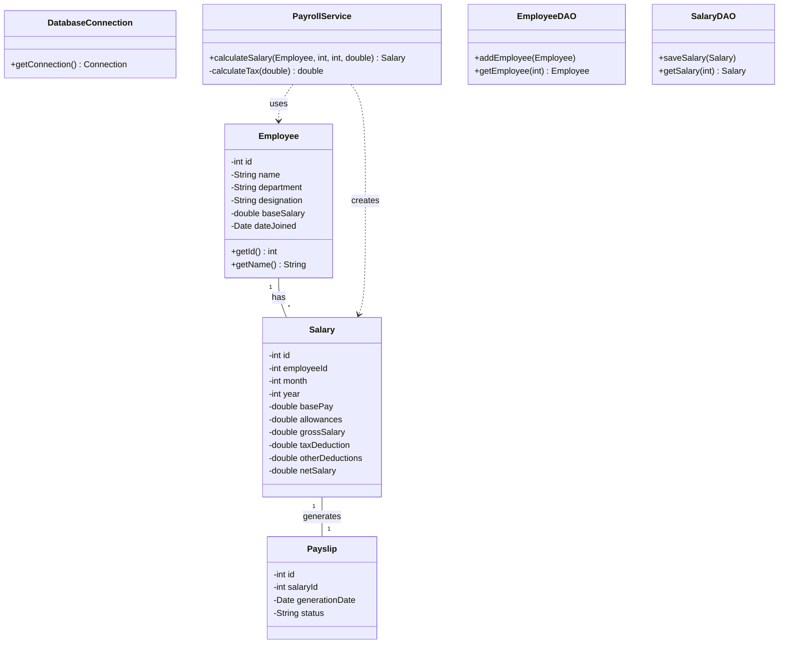
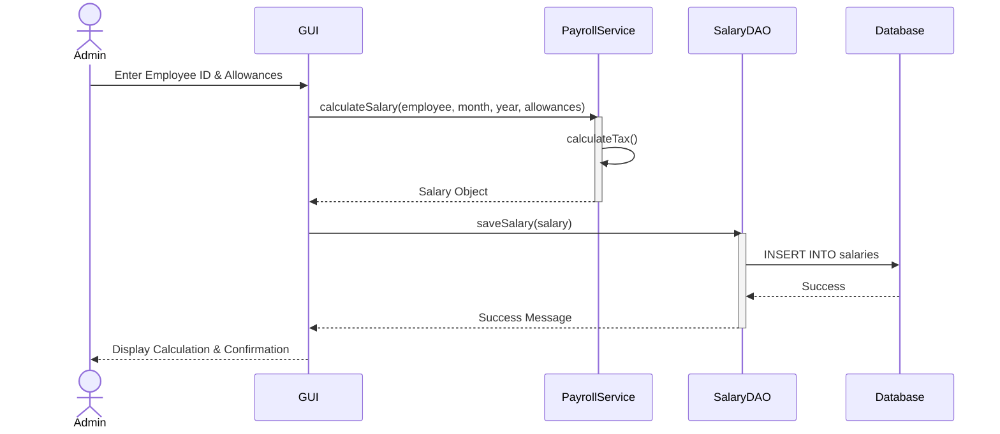

# UML Diagrams for Payroll Management System

## Use Case Diagram

```mermaid
usecaseDiagram
    actor Admin
    actor Employee

    package "Payroll Management System" {
        usecase "Manage Employees" as UC1
        usecase "Calculate Salary" as UC2
        usecase "Deduct Taxes" as UC3
        usecase "Generate Payslip" as UC4
        usecase "View Payslip" as UC5
    }

    Admin --> UC1
    Admin --> UC2
    Admin --> UC4
    UC2 ..> UC3 : <<include>>
    Employee --> UC5
```

## Class Diagram



## Sequence Diagram


